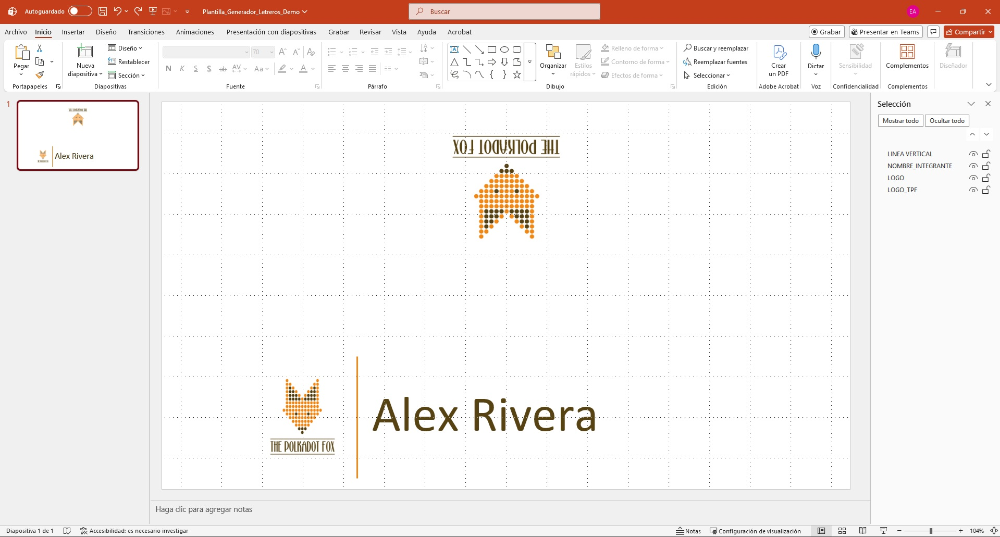
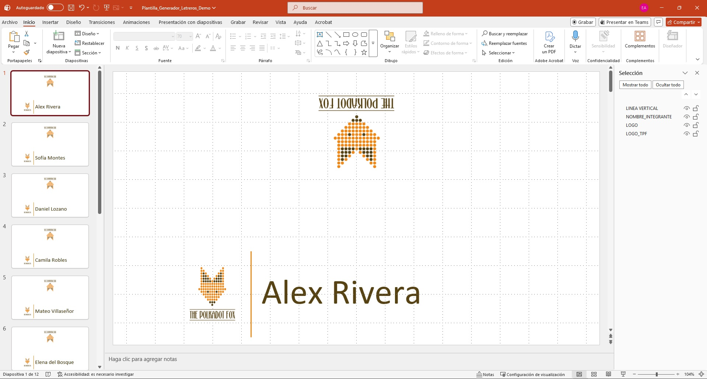

# PowerPoint VBA Name Card Generator

Automatización en VBA para generar letreros personalizados en PowerPoint a partir de una diapositiva plantilla y una lista de nombres.

> **Genera la lógica una vez. Ejecuta la repetición localmente.**

## Descripción

Este proyecto automatiza la creación de letreros personalizados en Microsoft PowerPoint.

La macro utiliza una diapositiva como plantilla, genera una copia por cada nombre incluido en una lista y modifica únicamente el cuadro de texto denominado `NOMBRE_INTEGRANTE`.

Los demás elementos visuales permanecen sin cambios.

## Problema

Crear manualmente una serie de letreros personalizados requiere duplicar una diapositiva, sustituir el nombre y verificar el formato de cada copia.

Cuando la lista contiene numerosas personas, el proceso se vuelve repetitivo y aumenta el riesgo de:

- Omitir nombres.
- Duplicar registros.
- Modificar accidentalmente el diseño.
- Generar formatos inconsistentes.
- Invertir tiempo operativo en una tarea de bajo valor.

## Solución

La automatización combina:

- Una diapositiva reutilizable como plantilla.
- Un cuadro de texto identificado como `NOMBRE_INTEGRANTE`.
- Una lista de nombres separada mediante delimitadores.
- Una macro de VBA que duplica la plantilla y sustituye el texto.
- Ajuste automático para mantener los nombres en una sola línea.

## Demostración

### Plantilla

La presentación comienza con una sola diapositiva:

### Resultado

Después de ejecutar la macro, PowerPoint genera automáticamente una diapositiva por cada nombre:

## Funcionalidades

- Generación automática de una diapositiva por nombre.
- Conservación del diseño original.
- Validación de la diapositiva plantilla.
- Validación del objeto `NOMBRE_INTEGRANTE`.
- Ajuste automático del tamaño del texto.
- Compatibilidad con caracteres acentuados.
- Mensaje de confirmación con la cantidad de letreros generados.
- Ejecución local dentro de PowerPoint.

## Estructura del proyecto
